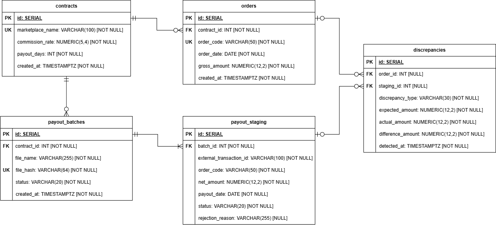
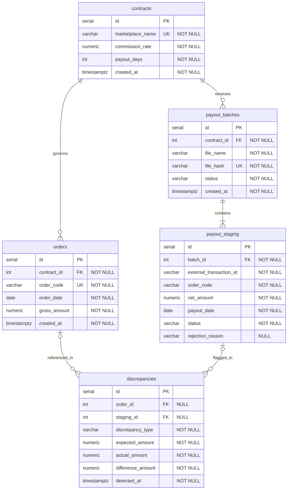

# Modelo de Dados — Marketplace Reconciliation API

Ver código Mermaid (erDiagram)

## Decisões de Modelagem

- **`payout_batches.file_hash` como `UNIQUE`:** Garante a idempotência da importação, fazendo o PostgreSQL bloquear automaticamente o reprocessamento caso o mesmo arquivo `.csv` seja enviado mais de uma vez.
- **`payout_staging.order_code` apenas como `VARCHAR` (sem `FK` para `orders`):** Escolha proposital para não bloquear repasses vinculados a pedidos inexistentes na base interna, permitindo que o registro entre na triagem e seja auditado como `ORPHAN_PAYOUT`.
- **`payout_staging.external_transaction_id` sem `UNIQUE`:** Permite que uma transação externa repetida (seja em outra linha do mesmo arquivo ou em uma importação futura) seja gravada na área de triagem para que o motor detecte e registre a divergência `DUPLICATE_PAYOUT`.
- **`order_id` e `staging_id` anuláveis (`NULL`) em `discrepancies`:** Necessário porque existem cenários em que apenas um dos lados existe — em `ORPHAN_PAYOUT` não há pedido interno correspondente (`order_id` fica nulo), enquanto em `MISSING_PAYOUT` não há linha de repasse no extrato (`staging_id` fica nulo).